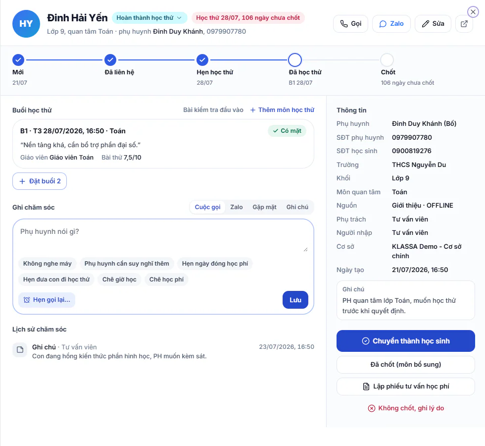

# Hồ sơ lead

Hồ sơ lead là nơi làm mọi việc với một khách quan tâm: gọi, ghi chăm sóc, đặt học thử, đổi trạng thái, chốt. Mở hồ sơ trước khi gọi để biết ai đã liên hệ và phụ huynh đã nói gì.

## Mở hồ sơ

::: steps
1. Vào **Tuyển sinh**.
2. Bấm vào một dòng lead trong danh sách (hoặc bấm tên lead ở khối **Lead mới vào hôm nay**). Khung hồ sơ mở ra bên phải màn hình.
3. Bấm dấu X ở góc trên để đóng.
:::

Ở đầu hồ sơ, biểu tượng mũi tên chéo (không có chữ, rê chuột vào sẽ thấy **Mở trang chi tiết (tab mới)**) mở lead trong một tab mới. Màn hình hẹp thì khung hồ sơ choán cả màn hình.

## Các phần trong khung hồ sơ

| Phần | Dùng để |
| --- | --- |
| Đầu hồ sơ | Tên lead, nhãn trạng thái (bấm để đổi), dòng nhỏ cho biết lead đang chờ gì. Nút **Gọi** và **Zalo** (khi lead có số điện thoại), biểu tượng thư để gửi email (khi có email), nút **Sửa**, và biểu tượng mở trang chi tiết. |
| Tiến trình 5 bước | **Mới**, **Đã liên hệ**, **Hẹn học thử**, **Đã học thử**, **Chốt** (hoặc **Không chốt**), kèm ngày từng bước. Bước bị nhảy qua hiện chữ **Bỏ qua**. |
| Dải vàng | Báo số điện thoại này trùng học sinh đã có hồ sơ hoặc trùng lead khác. |
| **Buổi học thử** | Từng buổi: ngày giờ, có mặt hay vắng, nhận xét của giáo viên. Xem [Đặt lịch và ghi kết quả học thử](dat-lich-hoc-thu.md). |
| **Ghi chăm sóc** | Ghi cuộc gọi, tin Zalo, buổi gặp, ghi chú. Xem [Ghi chăm sóc và hẹn gọi lại](hoat-dong-tu-van.md). |
| **Lịch sử chăm sóc** | Mọi việc đã làm với lead, mới nhất ở trên. |
| **Giáo viên gợi ý lớp** | Lớp giáo viên đề xuất sau buổi học thử (chỉ hiện khi giáo viên đã ghi). |
| **Thông tin** và **Ghi chú** | Thông tin liên hệ, người phụ trách, ghi chú của lead. |
| Các nút chốt | **Chuyển thành học sinh**, **Đã chốt (môn bổ sung)**, **Lập phiếu tư vấn học phí**, **Không chốt, ghi lý do**. |

Lead đã đóng (**Không chốt** hoặc **Đã chốt (môn bổ sung)**) không còn các nút chốt. Muốn mở lại, bấm nhãn trạng thái và chọn trạng thái mới.

## Sửa thông tin lead

::: steps
1. Trong hồ sơ, bấm **Sửa**. Phần **Sửa thông tin** hiện ra.
2. Sửa các ô cần thiết: **Tên học sinh** và **SĐT học sinh** (bắt buộc), **Phụ huynh**, **Quan hệ**, **SĐT phụ huynh**, **Email phụ huynh**, **Email học sinh**, **Khối**, **Học lực**, **Trường**, **Môn quan tâm**, **Nguồn**, **Kênh**, **Ngày sinh**, **Địa chỉ**, **Ghi chú**.
3. Bấm **Lưu thông tin**.
:::

Ô **Người phụ trách** chỉ hiện với Quản trị viên, Quản lý chi nhánh, Quản lý. Ô **Cơ sở** chỉ hiện với Quản trị viên khi hệ thống có nhiều cơ sở.

## Khi hồ sơ hiện dải vàng

Dải vàng xuất hiện khi số điện thoại của lead (số học sinh hoặc số phụ huynh) trùng với hồ sơ khác:

- **Trùng học sinh đã có hồ sơ**: hiện mã, tên và lớp đang học. Bấm mã để mở hồ sơ học sinh ở tab mới. Nếu chính em này đang học và đăng ký thêm môn, hãy chọn **Đã chốt (môn bổ sung)**, đừng chuyển thành học sinh mới. Nếu là anh chị em thì chuyển bình thường. Xem [Chuyển lead thành học sinh](chuyen-lead-thanh-hoc-sinh.md).
- **Còn ở lead khác**: bấm tên lead kia để xem. Là anh chị em thì giữ cả hai. Nhập trùng thì ghi tiếp ở một lead và báo quản lý xoá lead thừa.

## Câu hỏi thường gặp

::: details Bấm nhầm trạng thái thì sao?
Bấm nhãn trạng thái lần nữa và chọn lại. Lịch sử vẫn lưu cả hai lần đổi.
:::

::: details Lead đã thành học sinh có đặt học thử môn khác được không?
Được. Đặt ngay trên lead cũ của em. Trạng thái đã chốt của lead được giữ nguyên.
:::
