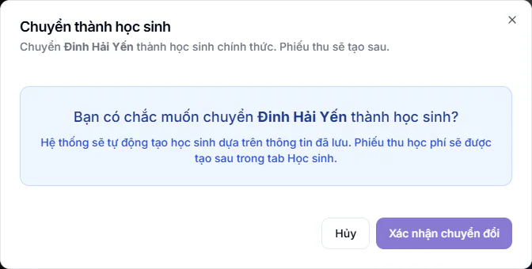

# Chuyển lead thành học sinh

Khi phụ huynh đồng ý cho con học, bạn "chốt" lead. Có hai cách chốt, tuỳ em là học sinh mới hay đang học ở trung tâm. Chọn đúng cách để không tạo hồ sơ học sinh trùng.

| Trường hợp | Chọn |
| --- | --- |
| Học sinh mới đăng ký | **Chuyển thành học sinh** |
| Học sinh đang học, đăng ký thêm môn | **Đã chốt (môn bổ sung)** |
| Phụ huynh không đăng ký | Xem [Ghi lý do không chốt](khong-chot-lead.md) |

So với [Tạo hồ sơ học sinh mới](../hoc-sinh/tao-moi.md), chuyển từ lead giữ nguyên thông tin đã thu thập khi tư vấn (môn quan tâm, trường, nguồn, ghi chú), bạn không phải gõ lại.

## Chuyển lead thành học sinh mới

::: steps
1. Mở [hồ sơ lead](chi-tiet-lead.md) và kiểm thông tin đã đủ, đúng chưa (tên, ngày sinh, phụ huynh, số điện thoại). Thiếu thì bấm **Sửa** và điền trước.
2. Bấm **Chuyển thành học sinh** ở cột nút chốt trong hồ sơ. Hoặc bấm **Chốt** ở cuối dòng lead trong danh sách, rồi chọn **Chuyển thành học sinh…**.
3. Hộp **Chuyển thành học sinh** hiện ra. Nút xác nhận hiện **Đang kiểm tra trùng…** trong giây lát. Đọc cảnh báo (nếu có), rồi bấm **Xác nhận chuyển đổi**.

   

4. Hệ thống tạo hồ sơ học sinh có mã học sinh và tự mở trang **Học sinh**.
:::

Hệ thống chỉ tạo học sinh. Em chưa vào lớp nào và chưa có phiếu thu. Bước tiếp theo là [ghi danh em vào lớp](../hoc-sinh/ghi-danh.md), sau đó tạo phiếu học phí. Nếu lead có tên và số điện thoại phụ huynh, hệ thống tạo hoặc nối kèm tài khoản [phụ huynh](../hoc-sinh/phu-huynh.md). Lead chuyển sang **Đã chuyển đổi** và khoá trạng thái.

### Khi hộp báo "Số điện thoại này trùng học sinh đã có hồ sơ"

Khi mở hộp, hệ thống so số điện thoại học sinh và phụ huynh với các hồ sơ học sinh hiện có. Nếu trùng, khung vàng hiện mã, tên, lớp đang học, và chữ "trùng cả tên" nếu tên cũng giống. Chọn theo từng trường hợp:

- **Chính em này đang học, đăng ký thêm môn** (thường trùng cả tên): bấm **Đổi sang Đã chốt (môn bổ sung)**. Không tạo hồ sơ mới.
- **Anh chị em** (cùng phụ huynh, khác tên): vẫn bấm **Xác nhận chuyển đổi** như bình thường.
- **Học sinh cũ đã nghỉ**: kiểm tra có phải chính em đó quay lại không. Phải thì hỏi quản lý trước khi chuyển, để không tạo hồ sơ trùng.

::: warning Lưu ý
Hệ thống cũng chặn khi đã có học sinh cùng tên, cùng số điện thoại và cùng phụ huynh. Khi đó bạn sẽ thấy thông báo "Học sinh đã tồn tại trong hệ thống" kèm mã học sinh cũ.
:::

## Chốt môn bổ sung cho học sinh đang học

::: steps
1. Mở hồ sơ lead, bấm **Đã chốt (môn bổ sung)**. Hoặc bấm **Chốt** ở cuối dòng và chọn cùng tên.
2. Trạng thái đổi ngay, không hỏi lại.
3. Vào [ghi danh](../hoc-sinh/ghi-danh.md) để xếp em vào lớp môn mới.
:::

Hệ thống không tạo học sinh mới vì em đã có hồ sơ. Nhãn **Đã chốt (môn bổ sung)** chỉ giúp nhận biết, nó không đổi lớp hay ghi danh của em.

::: danger Đừng bấm nhầm
Học sinh đang học thì không bấm **Chuyển thành học sinh**. Bấm nhầm sẽ tạo thêm một hồ sơ học sinh trùng. Bấm nhầm thì báo ngay quản lý để xử lý hồ sơ vừa tạo.
:::

## Kéo thả để chốt

Ở cách xem **Theo giai đoạn**, kéo thẻ lead vào ô **Chốt** thì hộp hỏi học sinh mới hay môn bổ sung. Xem [Trạng thái lead và bảng theo giai đoạn](pheu-tuyen-sinh.md).

## Câu hỏi thường gặp

::: details Chuyển xong có sửa lại được không?
Lead **Đã chuyển đổi** bị khoá trạng thái. Cần sửa thì báo quản lý. Thông tin học sinh sửa ở trang **Học sinh**.
:::

::: details Nút "Chuyển thành học sinh" không thấy?
Lead đã **Đã chốt (môn bổ sung)** hoặc **Không chốt** thì không còn các nút chốt. Muốn mở lại, bấm nhãn trạng thái và chọn trạng thái mới. Tài khoản không có quyền tạo học sinh cũng không thấy nút này.
:::
