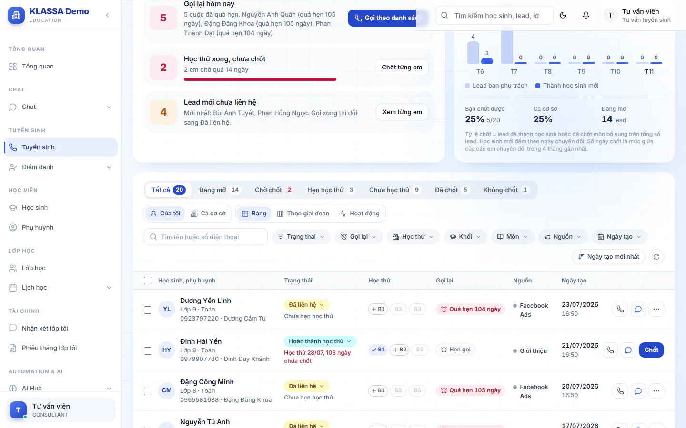
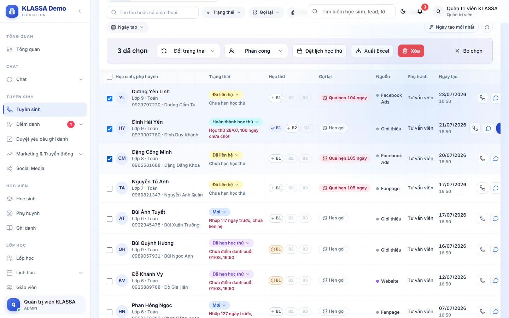

# Danh sách lead

**Lead** là khách quan tâm chưa đăng ký: người đã hỏi về lớp nhưng chưa trở thành học sinh. Danh sách lead nằm giữa trang **Tuyển sinh**, giúp bạn tìm đúng lead cần gọi hoặc cần chốt.

## Chọn nhóm, phạm vi và cách xem

Hàng nút trên cùng của danh sách chia lead thành các nhóm. Trang mở sẵn ở nhóm **Tất cả**.

| Nhóm | Gồm những lead |
| --- | --- |
| **Đang mở** | Mọi lead còn đang chăm sóc: Mới, Đã liên hệ, Tiềm năng, Đã hẹn học thử, Hoàn thành học thử. |
| **Chờ chốt** | Đã học thử xong, đang chờ phụ huynh quyết định. |
| **Hẹn học thử** | Đã có lịch học thử, chưa học xong. |
| **Chưa học thử** | Mới, Đã liên hệ, Tiềm năng: chưa đặt được buổi học thử nào. |
| **Đã chốt** | Đã chuyển thành học sinh hoặc Đã chốt (môn bổ sung). |
| **Không chốt** | Phụ huynh không đăng ký, đã ghi lý do. |
| **Tất cả** | Mọi lead. |

Bên phải có hai nhóm nút chuyển nhanh:

- **Của tôi** và **Cả cơ sở** (dành cho Lễ tân): xem lead mình phụ trách hoặc lead của mọi người. Bộ lọc **Phụ trách** chỉ hiện khi bạn chọn **Cả cơ sở** (Lễ tân) hoặc với vai quản lý, giúp xem theo từng người.
- **Bảng**, **Theo giai đoạn**, **Hoạt động**: ba cách xem. Xem [Trạng thái lead và bảng theo giai đoạn](pheu-tuyen-sinh.md) và [Ghi chăm sóc và hẹn gọi lại](hoat-dong-tu-van.md).

## Tìm và lọc

::: steps
1. Gõ vào ô **Tìm tên hoặc số điện thoại**. Ô tìm theo tên học sinh, tên phụ huynh, email hoặc số điện thoại (gõ vài số cuối cũng được).
2. Chọn các bộ lọc: **Trạng thái**, **Gọi lại**, **Học thử**, **Khối**, **Môn**, **Nguồn**, **Phụ trách**, **Cơ sở** (chỉ Quản trị viên khi hệ thống có nhiều cơ sở), và khoảng ngày tạo (**Hôm nay**, **7 ngày qua**, **Tháng này**, **Tháng trước** hoặc tự chọn trên lịch).
3. Muốn về danh sách đầy đủ, bấm **Xoá lọc**.
:::

Bộ lọc **Gọi lại** có các lựa chọn: **Cần gọi hôm nay (gồm quá hẹn)**, **Quá hẹn**, **Hẹn hôm nay**, **Hẹn ngày sau**, **Chưa hẹn**. Bộ lọc **Học thử** có: **Học thử hôm nay**, **Sắp học thử**, **Quá giờ, chưa điểm danh**, **Học thử 7 ngày qua**, **Vắng học thử 7 ngày qua**, **Đã học thử**.

Ở cách xem **Bảng**, nút **Sắp xếp** có ba kiểu: **Ngày tạo mới nhất** (mặc định), **Ngày tạo cũ nhất** và **Việc gấp trước** (đưa lên đầu lead quá hẹn gọi, buổi học thử chưa điểm danh, chờ chốt lâu, lead mới chưa liên hệ). Kiểu này không có ở nhóm **Đã chốt** và **Không chốt**.

## Đọc các cột trong bảng

| Cột | Ý nghĩa |
| --- | --- |
| Học sinh, phụ huynh | Tên học sinh, khối, môn quan tâm, số điện thoại, tên phụ huynh. |
| Trạng thái | Nhãn màu (bấm để đổi) và một dòng nhỏ cho biết lead đang chờ gì. |
| Học thử | Các ô **B1**, **B2**, **B3** là buổi học thử 1, 2, 3. Học thử nhiều môn thì mỗi môn một hàng. |
| Gọi lại | Giờ hẹn gọi lại. Chữ đỏ **Quá hẹn** là đã trễ hẹn. |
| Nguồn | Lead đến từ đâu. Chưa có thì hiện **+ Ghi nguồn**, bấm để chọn. |
| Ngày tạo | Ngày giờ nhập lead vào hệ thống. |
| Nút cuối dòng | Gọi điện, nhắn Zalo, **Chốt** (với lead đã học thử xong) hoặc nút mở thêm lựa chọn. |

Ở các ô học thử, ký hiệu có nghĩa như sau:

| Ô | Nghĩa là | Bấm vào thì |
| --- | --- | --- |
| **+ B1** | Chưa đặt buổi này | Mở hộp đặt lịch học thử |
| **◷ B1** | Đã hẹn, chưa đến giờ | Chọn **Ghi có mặt / vắng** hoặc **Đổi lịch** |
| **! B1** | Đã qua giờ mà chưa ghi có mặt hoặc vắng | Như trên, ghi ngay |
| **✓ B1** | Học sinh có mặt | Không cần làm gì |
| **✗ B2** | Học sinh vắng | Hẹn buổi khác |
| **B3** mờ | Chưa đặt được, phải xong buổi trước | Không bấm được |

Rê chuột lên một ô sẽ hiện chữ giải thích.

## Chọn nhiều lead một lúc

::: steps
1. Tích ô vuông đầu các dòng. Ô ở tiêu đề bảng chọn cả trang.
2. Thanh phía trên hiện số lead **đã chọn** cùng các thao tác.
3. Chọn thao tác: **Đổi trạng thái**, **Phân công**, **Đặt lịch học thử**, **Xuất Excel**, **Xóa**. Bấm **Bỏ chọn** để thôi.

   
:::

- **Đổi trạng thái** hàng loạt bị khoá nếu trong nhóm đã chọn có lead **Đã chuyển đổi**. Chọn **Không chốt** thì phải chọn một lý do chung.
- **Phân công** và **Đặt lịch học thử** dành cho Quản trị viên, Quản lý chi nhánh, Quản lý.
- **Xuất Excel** dành cho Quản trị viên và Quản lý chi nhánh.
- **Xóa** dành cho vai có quyền xoá lead (Quản trị viên, Quản lý chi nhánh, Quản lý).

::: danger Không thể hoàn tác
Xoá lead là xoá hẳn hồ sơ lead cùng lịch sử chăm sóc. Chỉ xoá lead nhập trùng hoặc nhập nhầm.
:::

## Nhập danh sách từ Excel

Có danh sách từ sự kiện hoặc tờ rơi: bấm **Excel** ở dải trên cùng, chọn **Nhập lead từ Excel**. Cách nhập từng bước xem [Nhập dữ liệu hàng loạt từ Excel](../tai-khoan/nhap-du-lieu-hang-loat.md).

## Câu hỏi thường gặp

::: details Dòng nhỏ "Học thử 27/09, 15 ngày chưa chốt" nghĩa là gì?
Buổi học thử có mặt gần nhất là 27/09, đến nay 15 ngày mà phụ huynh chưa quyết. Màu xanh là dưới 8 ngày, cam là 8 đến 14 ngày, đỏ là từ 15 ngày. Hãy gọi chốt hoặc hẹn gọi lại.
:::

::: details Lead "Đã chuyển đổi" không đổi trạng thái được?
Đúng như vậy: lead đã thành học sinh thì khoá trạng thái. Bạn vẫn ghi chăm sóc và đặt học thử môn khác được. Cần sửa thì báo quản lý.
:::
