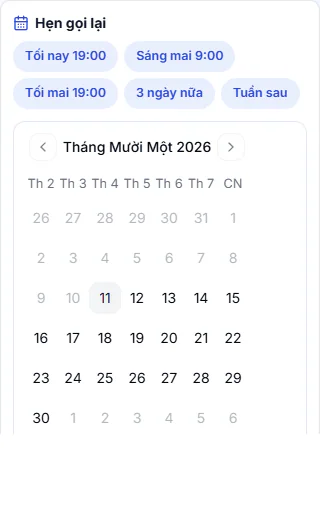

# Ghi chăm sóc và hẹn gọi lại

Mỗi lần gọi điện, nhắn Zalo hay gặp phụ huynh, bạn ghi lại một dòng chăm sóc. Nhờ vậy cả cơ sở biết lead đã được liên hệ mấy lần, ai cũng không gọi trùng hay bỏ sót. Mỗi lead đang mở nên luôn có một giờ hẹn gọi lại.

## Ghi một lần chăm sóc

::: steps
1. Mở [hồ sơ lead](chi-tiet-lead.md). Bấm nút gọi (trên điện thoại sẽ gọi luôn) hoặc nút Zalo để liên hệ phụ huynh.
2. Ở phần **Ghi chăm sóc**, chọn loại ghi chép: **Cuộc gọi**, **Zalo**, **Gặp mặt** hoặc **Ghi chú** (ghi chú nội bộ).
3. Gõ lại phụ huynh nói gì. Có thể bấm các câu có sẵn để ghi nhanh: **Không nghe máy**, **Phụ huynh cần suy nghĩ thêm**, **Hẹn ngày đóng học phí**, **Hẹn đưa con đi học thử**, **Chê giờ học**, **Chê học phí**.
4. Với lead đang ở trạng thái **Mới** (và loại ghi chép không phải **Ghi chú**): có một ô cho biết đã nói chuyện được với phụ huynh hay chưa. Để tích thì sau khi lưu, lead tự sang **Đã liên hệ**.
5. Bấm **Hẹn gọi lại…** để chọn giờ gọi lần sau (xem mục dưới).
6. Bấm **Lưu** (hoặc Ctrl + Enter). Dòng ghi chép hiện ngay trong **Lịch sử chăm sóc**.
:::

Nếu ghi các câu như "không nghe máy", "thuê bao", "máy bận", ô nói chuyện được tự bỏ tích và lead vẫn giữ trạng thái **Mới**.

::: tip Gọi không được cũng phải ghi
Ghi **Không nghe máy** và hẹn giờ gọi lại. Cả cơ sở sẽ biết lead đã được gọi.
:::

## Hẹn gọi lại

Đặt giờ ở cột **Gọi lại** trong danh sách (bấm ô **Hẹn gọi**) hoặc ở nút **Hẹn gọi lại…** trong hồ sơ.

::: steps
1. Bấm ô **Hẹn gọi** hoặc nút **Hẹn gọi lại…**.
2. Chọn nhanh một mốc: **Tối nay 19:00** (hiện trước 18 giờ) hoặc **Sau 1 tiếng** (hiện từ 18 đến 20 giờ), **Sáng mai 9:00**, **Tối mai 19:00**, **3 ngày nữa**, **Tuần sau**.
3. Hoặc chọn ngày trên lịch, gõ **Giờ** theo kiểu 24 giờ (ví dụ 18:30), rồi bấm **Đặt hẹn**.
:::

Đã có hẹn thì ô hiện giờ hẹn, ví dụ **Hôm nay 19:00** hoặc **Mai 09:00**. Quá giờ mà chưa gọi thì chuyển đỏ **Quá hẹn**. Bấm vào để đổi giờ hoặc chọn **Bỏ hẹn gọi lại**. Các lead tới hẹn hôm nay (kể cả quá hẹn) hiện ở việc **Gọi lại hôm nay** trên đầu trang **Tuyển sinh**. Xem [Trang Tuyển sinh](ban-tuyen-sinh.md).

## Xem nhật ký hoạt động

Bấm **Hoạt động** ở nhóm nút cách xem để thấy các cuộc gọi, ghi chú và thay đổi gần đây của mọi lead, mới nhất ở trên. Ô chọn khoảng thời gian có: **7 ngày gần nhất**, **30 ngày gần nhất**, **90 ngày gần nhất**, **Toàn bộ lịch sử**.

Mỗi dòng có nhãn loại: **Cuộc gọi**, **Email**, **SMS**, **Zalo**, **Gặp mặt**, **Ghi chú**, **Theo dõi**.

## Câu hỏi thường gặp

::: details Tôi ghi chăm sóc xong nhưng lead vẫn là "Mới"?
Có thể ô nói chuyện được với phụ huynh chưa được tích, hoặc nội dung ghi là "không nghe máy", "thuê bao", "máy bận". Khi đã nói chuyện được, bấm nhãn trạng thái và chọn **Đã liên hệ**.
:::

::: details Lead đã chuyển thành học sinh có ghi chăm sóc tiếp được không?
Được. Lead đã chuyển đổi chỉ bị khoá việc đổi trạng thái.
:::
