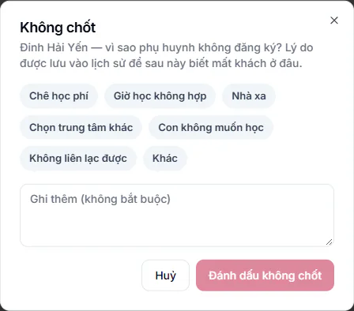

# Ghi lý do không chốt

Khi phụ huynh quyết định không cho con học, bạn đánh dấu lead là **Không chốt** và chọn lý do. Lý do được lưu vào lịch sử chăm sóc, giúp trung tâm biết mình đang mất khách vì đâu.

## Đánh dấu không chốt

::: steps
1. Mở [hồ sơ lead](chi-tiet-lead.md), bấm **Không chốt, ghi lý do**. Hoặc bấm **Chốt** ở cuối dòng lead trong danh sách rồi chọn **Không chốt…**.
2. Chọn một lý do (bắt buộc): **Chê học phí**, **Giờ học không hợp**, **Nhà xa**, **Chọn trung tâm khác**, **Con không muốn học**, **Không liên lạc được**, **Khác**.

   
3. Ghi thêm chi tiết vào ô **Ghi thêm (không bắt buộc)** nếu có.
4. Bấm **Đánh dấu không chốt**.
:::

Chưa chọn lý do thì nút **Đánh dấu không chốt** chưa bấm được. Có thể làm như vậy cho nhiều lead cùng lúc: chọn các dòng, rồi **Đổi trạng thái** thành **Không chốt** và chọn một lý do chung.

::: warning Lưu ý
Phụ huynh chỉ đang suy nghĩ thì đừng chọn **Không chốt** vội. Hãy ghi một cuộc gọi (ví dụ **Phụ huynh cần suy nghĩ thêm**) và [hẹn ngày gọi lại](hoat-dong-tu-van.md).
:::

## Mở lại lead đã không chốt

Phụ huynh quay lại sau này: bấm nhãn **Không chốt**, chọn trạng thái phù hợp để mở lại lead. Hoặc đặt lịch học thử mới cho em. Xem [Đặt lịch và ghi kết quả học thử](dat-lich-hoc-thu.md).

## Câu hỏi thường gặp

::: details Bấm nhầm Không chốt thì làm sao?
Bấm nhãn trạng thái lần nữa và chọn lại trạng thái đúng. Lịch sử vẫn lưu cả hai lần đổi.
:::

::: details Xem lead đã không chốt ở đâu?
Mở nhóm **Không chốt** trong [Danh sách lead](danh-sach-lead.md).
:::
