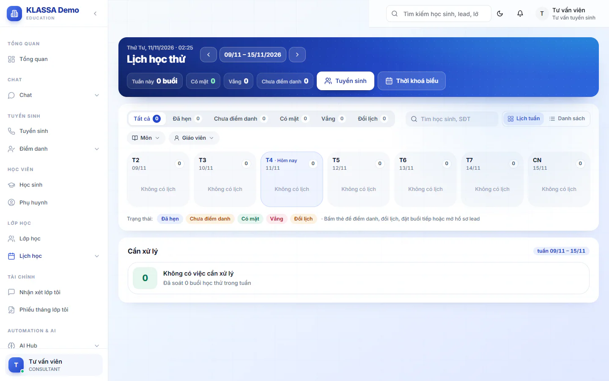
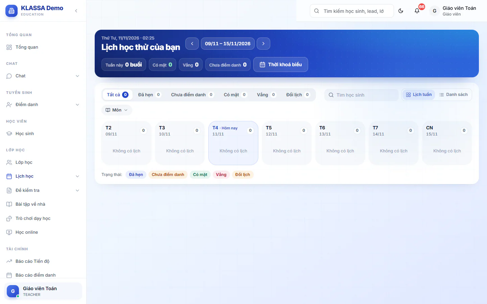

# Lịch học thử

Lịch học thử cho bạn thấy mọi buổi học thử của cơ sở trong một tuần: ai học, môn gì, giờ nào, giáo viên nào, đã điểm danh chưa. Lễ tân dùng lịch này để chuẩn bị đón học sinh và nhắc việc quên điểm danh. Giáo viên và trợ giảng dùng để biết buổi học thử mình được giao.

## Mở lịch và đọc lịch

::: steps
1. Vào **Lịch học → Lịch học thử**, hoặc bấm **Lịch học thử** ở dải trên cùng trang **Tuyển sinh**.
2. Dùng hai nút mũi tên **Tuần trước** và **Tuần sau** để xem tuần khác. Nút **Tuần này** chỉ hiện khi bạn đang xem tuần khác, bấm để quay về tuần hiện tại. Tuần tính từ Thứ Hai đến Chủ nhật.
3. Chọn kiểu xem: **Lịch tuần** (mỗi ngày một cột) hoặc **Danh sách** (mỗi ngày một nhóm).
:::

Ở góc dải đầu trang có hai nút tắt: **Tuyển sinh** (về trang Tuyển sinh, giáo viên và trợ giảng không thấy nút này) và **Thời khoá biểu** (sang thời khoá biểu lớp học). Dải đầu trang tóm tắt tuần đang xem: tổng số buổi, số buổi **Có mặt**, **Vắng**, **Chưa điểm danh**. Mỗi thẻ buổi học thử có một trong các nhãn:

| Nhãn | Nghĩa là |
| --- | --- |
| **Đã hẹn** | Đã đặt lịch, chưa đến giờ. |
| **Chưa điểm danh** | Đã qua giờ mà chưa ai ghi có mặt hay vắng. |
| **Có mặt** | Học sinh đã đến học thử. |
| **Vắng** | Học sinh không đến. |
| **Đổi lịch** | Buổi này từng được dời giờ. |

## Lọc và tìm

- Bấm các nhãn trên hàng đếm (**Tất cả**, **Đã hẹn**, **Chưa điểm danh**, **Có mặt**, **Vắng**, **Đổi lịch**) để lọc theo trạng thái.
- Gõ vào ô **Tìm học sinh, SĐT** để tìm theo tên học sinh hoặc số điện thoại.
- Dùng bộ lọc **Môn**, **Giáo viên** (có lựa chọn **Chưa có giáo viên**) và **Chi nhánh** (Quản trị viên, khi hệ thống có nhiều cơ sở).

## Xử lý việc cần làm trong tuần

Khối **Cần xử lý** liệt kê các việc còn tồn:

| Việc | Nút | Ý nghĩa |
| --- | --- | --- |
| **Học sinh vắng buổi học thử** | **Xem** | Gọi phụ huynh hẹn buổi khác. |
| **Buổi đã qua chưa điểm danh** | **Điểm danh** | Ghi có mặt hoặc vắng cho buổi đã qua. |
| **Buổi học thử chưa có giáo viên** | **Xem** | Mở các buổi chưa có giáo viên, báo quản lý xếp giáo viên. |
| **Đã học thử, chưa chốt** | **Xem** | Gọi phụ huynh để chốt. |

Không còn việc nào thì khối hiện **Không có việc cần xử lý**.

## Thao tác trên một buổi

Bấm vào thẻ buổi học thử để mở danh sách thao tác (Quản trị viên, Quản lý chi nhánh, Quản lý, Lễ tân):

- **Ghi có mặt / vắng** (hoặc **Sửa điểm danh** với buổi đã ghi).
- **Đổi lịch** (với buổi còn đang chờ).
- **Đặt lịch buổi 2**, **Đặt lịch buổi 3**.
- **Mở hồ sơ, ghi cuộc gọi**.
- **Mọi buổi học thử của lead**.
- **Phiếu tư vấn**. Xem [Lập phiếu tư vấn học phí](phieu-tu-van-hoc-phi.md).
- Gọi số điện thoại phụ huynh.

Chi tiết từng thao tác xem [Đặt lịch và ghi kết quả học thử](dat-lich-hoc-thu.md). Lịch học thử không có nút huỷ buổi. Muốn đổi giờ, dùng **Đổi lịch**.

## Giáo viên và trợ giảng

Giáo viên và trợ giảng thấy trang tên **Lịch học thử của bạn**, chỉ gồm các buổi mình được giao. Họ chỉ xem, không thao tác trên buổi học thử và không thấy số điện thoại của lead. Bộ lọc giáo viên và chi nhánh không hiện.

## Câu hỏi thường gặp

::: details Vì sao không thấy buổi học thử của tuần trước?
Lịch chỉ tải tuần đang xem. Dùng nút chuyển tuần để quay lại.
:::

::: details Tôi là giáo viên, tại sao không bấm được vào buổi học thử?
Giáo viên chỉ xem lịch. Việc điểm danh và đổi lịch do Lễ tân hoặc quản lý làm.
:::
