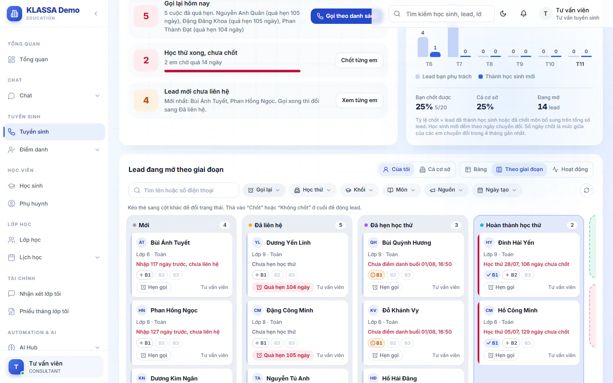

# Trạng thái lead và bảng theo giai đoạn

Trạng thái cho biết lead đang ở bước nào trên đường từ "vừa hỏi" đến "đã chốt". Hiểu đúng trạng thái giúp bạn lọc đúng việc và không bỏ sót khách. Báo cáo tổng hợp theo trạng thái nằm ở [Phễu tuyển sinh trong báo cáo](../bao-cao/pheu-tuyen-sinh.md).

## Các trạng thái

| Trạng thái | Dùng khi |
| --- | --- |
| **Mới** | Vừa nhập, chưa nói chuyện được với phụ huynh. |
| **Đã liên hệ** | Đã nói chuyện được với phụ huynh. Tự đổi khi bạn ghi một cuộc gọi có tích đã nói chuyện được. |
| **Tiềm năng** | Phụ huynh có nhu cầu rõ, đang cân nhắc, chưa hẹn học thử. |
| **Đã hẹn học thử** | Tự đổi khi đặt buổi học thử 1. |
| **Hoàn thành học thử** | Tự đổi khi ghi **Đã tham gia** cho một buổi học thử. Lead vào nhóm **Chờ chốt**. |
| **Đã chuyển đổi** | Lead đã thành học sinh. Chỉ đến được qua bước [chuyển thành học sinh](chuyen-lead-thanh-hoc-sinh.md). Trạng thái này bị khoá. |
| **Đã chốt (môn bổ sung)** | Học sinh đang học chốt học thêm môn. Xem [Chuyển lead thành học sinh](chuyen-lead-thanh-hoc-sinh.md). |
| **Không chốt** | Phụ huynh không đăng ký. Luôn phải chọn lý do. Xem [Ghi lý do không chốt](khong-chot-lead.md). |

Đặt lịch học thử và ghi có mặt đã tự đổi trạng thái, nên thường bạn chỉ cần tự đổi ở các lần: đã liên hệ, tiềm năng, chốt và không chốt.

## Đổi trạng thái bằng tay

::: steps
1. Bấm vào nhãn trạng thái của lead (trong danh sách hoặc ở đầu hồ sơ).
2. Chọn trạng thái mới trong danh sách.
3. Menu liệt kê 5 trạng thái đang mở (từ **Mới** đến **Hoàn thành học thử**), rồi các mục **Chuyển thành học sinh…**, **Đã chốt (môn bổ sung)…** và **Không chốt…**. Chọn **Chuyển thành học sinh…** thì hộp chuyển đổi hiện ra. Chọn **Không chốt…** thì hộp chọn lý do hiện ra. Các mục còn lại đổi ngay, không hỏi lại.
:::

Bấm nhầm thì bấm nhãn lần nữa và chọn lại. Lead **Đã chuyển đổi** thì không đổi được nữa, hệ thống báo "Lead đã chuyển thành học sinh, không đổi trạng thái được nữa".

## Xem theo giai đoạn

Bấm **Theo giai đoạn** ở nhóm nút cách xem. Mỗi cột là một trạng thái đang mở, mỗi thẻ là một lead. Cột **Tiềm năng** chỉ hiện khi đang có ít nhất một lead ở trạng thái này, nên bảng có thể chỉ thấy bốn cột từ **Mới** đến **Hoàn thành học thử**.

::: steps
1. Bấm **Theo giai đoạn** phía trên danh sách.
2. Kéo thẻ lead sang cột khác để đổi trạng thái.
3. Muốn đóng lead, kéo thẻ vào ô **Chốt** hoặc **Không chốt** ở cuối bảng.
4. Bấm vào thẻ để mở hồ sơ lead.
:::

- Thả vào **Chốt**: hộp hỏi em là học sinh mới (chuyển thành học sinh) hay học sinh đang học chốt thêm môn (**Đã chốt (môn bổ sung)**).
- Thả vào **Không chốt**: hộp hỏi lý do.
- Bảng chỉ hiện tối đa 500 lead (lead tạo gần nhất xếp trước). Dùng bộ lọc để thu hẹp.
- Chỉ người có quyền sửa lead mới kéo thả được.

::: tip Mẹo
Viền màu bên trái thẻ cho biết lead chờ lâu (cam, đỏ). Ưu tiên gọi các thẻ này trước.
:::

## Câu hỏi thường gặp

::: details Vì sao lead đã học thử mà không vào nhóm Chờ chốt?
Buổi học thử chưa được ghi **Đã tham gia**. Buổi không ghi sẽ hiện **Chưa điểm danh** màu đỏ. Hãy [ghi có mặt hoặc vắng](dat-lich-hoc-thu.md) ngay sau buổi.
:::

::: details Phụ huynh quay lại sau khi tôi đã đánh dấu Không chốt?
Bấm nhãn **Không chốt**, chọn trạng thái phù hợp để mở lại lead, hoặc đặt lịch học thử mới.
:::
