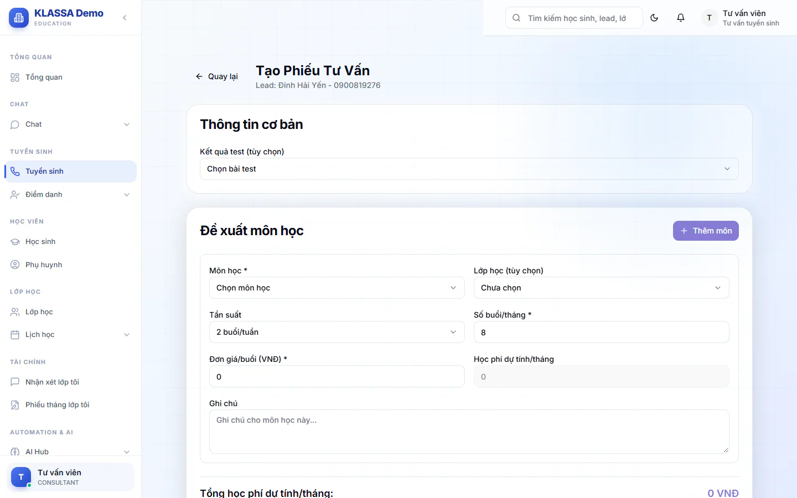

# Lập phiếu tư vấn học phí

Phiếu tư vấn là bản ghi các môn bạn đề xuất cho học sinh, kèm số buổi và học phí dự tính mỗi tháng. Dùng khi phụ huynh muốn biết con học những môn nào và tốn bao nhiêu. Đây là bản dự tính để tư vấn, không phải hoá đơn. Phiếu thu thật tạo sau, ở phần học phí.

## Lập phiếu

::: steps
1. Mở [hồ sơ lead](chi-tiet-lead.md), bấm **Lập phiếu tư vấn học phí**. Hoặc ở [Lịch học thử](lich-hoc-thu.md), bấm vào thẻ buổi học thử rồi chọn **Phiếu tư vấn**. Trang **Tạo Phiếu Tư Vấn** mở ra, đầu trang ghi tên và số điện thoại của lead.

   
2. Ở phần **Thông tin cơ bản**, có thể chọn **Kết quả test (tùy chọn)** từ các buổi học thử của lead. Ô này lúc đầu hiện chữ gợi ý **Chọn bài test**. Không cần thì để nguyên hoặc chọn **Không chọn** trong danh sách.
3. Ở phần **Đề xuất môn học**, chọn **Môn học** (bắt buộc). Có thể chọn thêm **Lớp học (tùy chọn)**.
4. Chọn **Tần suất** (2, 3, 4 hoặc 5 buổi mỗi tuần), điền **Số buổi/tháng** và **Đơn giá/buổi (VNĐ)**. Cả hai ô số phải lớn hơn 0.
5. **Học phí dự tính/tháng** của môn tự tính bằng số buổi nhân đơn giá. Ghi **Ghi chú** riêng cho môn nếu cần.
6. Đề xuất nhiều môn thì bấm **Thêm môn** và làm lại bước 3 đến 5. Phần **Tổng học phí dự tính/tháng** tự cộng các môn.
7. Ghi **Ghi chú chung** cho cả phiếu nếu cần.
8. Bấm **Lưu nháp** để lưu chưa gửi, hoặc **Gửi phiếu tư vấn** để hoàn tất.
:::

Phải có ít nhất một môn và môn nào cũng phải chọn **Môn học**, nếu không hệ thống báo lỗi và chưa lưu. Lưu xong, bạn quay lại trang lead.

::: tip Mẹo
Số buổi mặc định là 8 buổi mỗi tháng. Sửa lại theo tần suất bạn tư vấn cho phụ huynh.
:::

## Câu hỏi thường gặp

::: details Phiếu tư vấn có thay hoá đơn học phí không?
Không. Đây chỉ là bản dự tính. Học phí thật tính theo gói học phí khi tạo hoá đơn. Xem [Tạo hoá đơn](../hoc-phi/tao-hoa-don.md).
:::

::: details Đơn giá tôi nhập có đổi giá của lớp không?
Không. Đơn giá chỉ dùng trong phiếu tư vấn này.
:::
