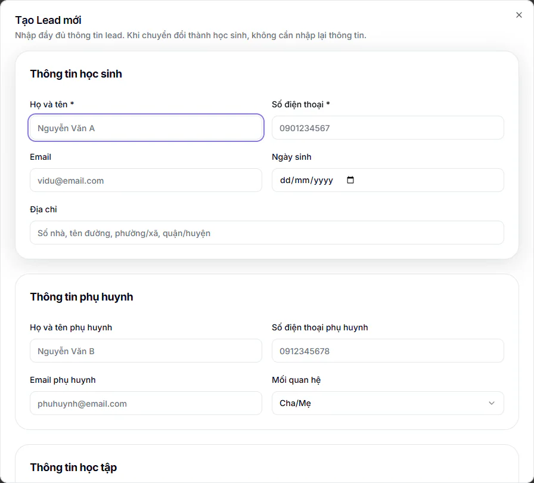

# Tạo lead mới

Khi phụ huynh gọi, nhắn Zalo hoặc đến hỏi trực tiếp, hãy ghi ngay vào hệ thống để không ai quên gọi lại. Thông tin nhập lúc này sẽ được giữ nguyên khi [chuyển lead thành học sinh](chuyen-lead-thanh-hoc-sinh.md).

## Tạo một lead

::: steps
1. Vào **Tuyển sinh**, bấm **Tạo lead mới** ở dải trên cùng. Hộp **Tạo Lead mới** hiện ra.
2. Ở phần **Thông tin học sinh**, điền **Họ và tên** và **Số điện thoại** (hai ô bắt buộc). Có thể điền thêm **Email**, **Ngày sinh**, **Địa chỉ**.
3. Ở phần **Thông tin phụ huynh**, điền tên, số điện thoại, email phụ huynh và chọn **Mối quan hệ** (Cha/Mẹ, Người giám hộ, Ông/Bà, Họ hàng, Khác).
4. Ở phần **Thông tin học tập**, điền **Trường hiện tại**, chọn **Khối lớp**, **Trình độ học lực** (Xuất sắc, Giỏi, Trung bình, Yếu), **Cơ sở** và **Môn học quan tâm**. Chọn nhiều môn được, bấm dấu x trên nhãn môn để bỏ.
5. Ở phần **Nguồn lead & Kênh tiếp cận**, chọn **Nguồn lead** và **Kênh tiếp cận**.
6. Ghi vào **Ghi chú** những gì phụ huynh nói, rồi bấm **Tạo Lead**.
:::

Nguồn lead có sẵn: Zalo, Facebook, Phụ huynh/Học sinh giới thiệu, Tư vấn trực tiếp, Website, Google Ads, Sự kiện, Khác. Kênh tiếp cận có sẵn: Trực tiếp, Chạy Ads, Giới thiệu, Mạng xã hội, Telesales, Sự kiện.

Lead mới có trạng thái **Mới**. Lễ tân tạo lead thì lead tự giao cho chính người đó. Khi Quản trị viên, Quản lý chi nhánh hoặc Quản lý tạo, hệ thống giao cho một Lễ tân đang hoạt động cùng cơ sở (nếu có).

::: tip Mẹo
Luôn chọn **Nguồn lead**. Nhờ đó trung tâm biết kênh nào mang về nhiều học sinh. Thấy lead nào hiện **+ Ghi nguồn** thì hỏi phụ huynh "anh chị biết trung tâm qua đâu" rồi ghi lại.
:::

## Khi có người giới thiệu

Nhập số điện thoại của người giới thiệu vào ô **SĐT người giới thiệu**. Ô hiện **Hợp lệ** nếu tìm thấy học sinh hoặc phụ huynh có số đó. Người giới thiệu được cộng 10 điểm thưởng khi học sinh ghi danh thành công. Ô này không bắt buộc.

## Khi hiện cảnh báo trùng số điện thoại

Trước khi tạo, hãy tìm thử số điện thoại ở ô tìm của danh sách. Phụ huynh đã từng hỏi thì ghi tiếp vào lead cũ, đừng tạo thêm.

Nếu số điện thoại trùng với lead hoặc phụ huynh đã có, hộp hiện khung vàng **Cảnh báo: Trùng số điện thoại với lead/phụ huynh đã có**, liệt kê các lead trùng kèm trạng thái và ngày tạo. Bạn chọn:

- **Hủy**: quay lại, dùng lead cũ.
- **Xác nhận tạo lead**: vẫn tạo, dùng khi đó là anh chị em cùng gia đình.

## Các cách khác để có lead

- Nhập cả danh sách: bấm **Excel**, chọn **Nhập lead từ Excel**. Xem [Danh sách lead](danh-sach-lead.md).
- Phụ huynh tự điền form trên web: xem [Form đăng ký học thử trên web](yeu-cau-dang-ky.md).

## Câu hỏi thường gặp

::: details Tôi chỉ có tên và số điện thoại, có tạo được không?
Được. Chỉ **Họ và tên** và **Số điện thoại** là bắt buộc. Các ô còn lại bổ sung sau bằng nút **Sửa** trong [hồ sơ lead](chi-tiet-lead.md).
:::

::: details Tạo xong thì lead nằm ở đâu?
Ở danh sách **Tuyển sinh**, trạng thái **Mới**. Lễ tân thấy ngay trong **Của tôi**.
:::
