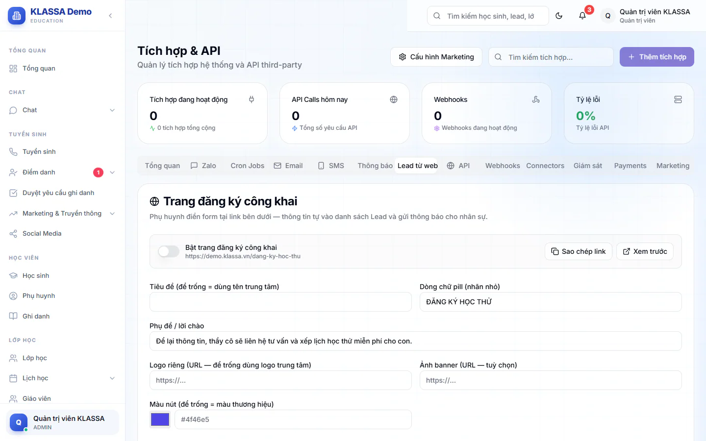
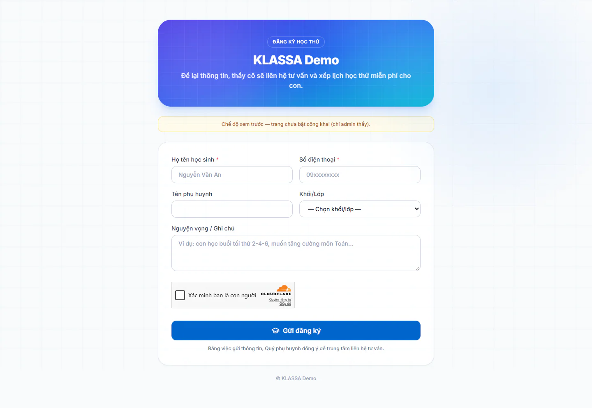

# Form đăng ký học thử trên web

Trung tâm có sẵn một trang đăng ký học thử công khai, phụ huynh không cần đăng nhập. Dán link trang này lên website, quảng cáo hay tin nhắn Zalo. Mỗi phụ huynh điền form là một lead mới tự xuất hiện trong [danh sách lead](danh-sach-lead.md), lễ tân không phải nhập tay.

Trang cần gói mở rộng **CRM Tuyển sinh + AI**. Mặc định trang tắt: phụ huynh vào sẽ thấy "Hiện chưa mở đăng ký online" cho đến khi Quản trị viên hoặc Quản lý chi nhánh bật.

## Bật và cấu hình trang đăng ký

::: steps
1. Vào **Tích hợp**, mở tab **Lead từ web**.
2. Bật công tắc **Bật trang đăng ký công khai**. Link trang hiện ngay bên cạnh công tắc.
3. Bấm **Sao chép link** để lấy link dán vào website hoặc quảng cáo. Bấm **Xem trước** để xem trang trong tab mới.
4. Chỉnh giao diện trang: **Tiêu đề** (để trống thì dùng tên trung tâm), **Dòng chữ pill (nhãn nhỏ)** là dòng chữ nhỏ phía trên tiêu đề (mặc định là "ĐĂNG KÝ HỌC THỬ"), phụ đề, logo riêng, ảnh banner, màu nút, tiêu đề và lời cảm ơn hiển thị sau khi gửi, link sau khi gửi, dòng đồng ý.
5. Ở bảng **Các trường trên form**, chọn trường nào **Hiện**, trường nào **Bắt buộc**, và sửa **Nhãn hiển thị**.
6. Nhập **Danh sách môn quan tâm** (mỗi dòng một môn), chọn **Cơ sở mặc định**.
7. Bấm **Lưu cấu hình**.
:::

Các trường có thể bật hoặc tắt: Tên phụ huynh, SĐT phụ huynh, Email, Khối/Lớp, Trường đang học, Môn quan tâm, Nguyện vọng / Ghi chú. Hai trường **Họ tên học sinh** và **Số điện thoại** luôn bật và luôn bắt buộc. Mặc định đang bật: Tên phụ huynh, Khối/Lớp, Nguyện vọng / Ghi chú.

### Cấu hình chống đăng ký rác

Cũng ở tab này bạn có thể đặt:

- **Trần số đăng ký / ngày / cơ sở**: số lead tối đa mỗi ngày mỗi cơ sở.
- **Chặn trùng SĐT trong (ngày)**: đặt 0 là tắt chặn theo ngày. Dù vậy hệ thống vẫn bỏ qua lần gửi thứ hai nếu cùng số điện thoại gửi lại trong vòng khoảng 1 phút.
- **Chống bot (captcha)**: chọn dịch vụ xác nhận chống bot nếu cần.
- **Bắt phụ huynh chọn cơ sở (nếu nhiều cơ sở)**: bật khi trung tâm có nhiều cơ sở.

## Phụ huynh điền form như thế nào

Trang hiện tên trung tâm, các ô theo cấu hình của bạn và nút **Gửi đăng ký**. Phụ huynh phải điền họ tên học sinh (từ 2 ký tự) và số điện thoại. Điền xong, trang hiện lời cảm ơn.

## Lead từ web về đâu

- Lead có trạng thái **Mới** và tự giao cho một Lễ tân đang hoạt động cùng cơ sở.
- Nếu số điện thoại trùng học sinh đang học, lead vẫn được tạo và có ghi chú "SĐT trùng học sinh đang học" để bạn kiểm tra.
- Hệ thống gửi thông báo "Lead mới" cho các vai được bật trong cấu hình thông báo. Có nút **Mở cấu hình thông báo** ngay trong tab **Lead từ web**.

Lễ tân gọi lại trong ngày. Xem [Trang Tuyển sinh](ban-tuyen-sinh.md) và [Ghi chăm sóc và hẹn gọi lại](hoat-dong-tu-van.md).

## Câu hỏi thường gặp

::: details Phụ huynh báo vào link thấy "Hiện chưa mở đăng ký online"?
Công tắc **Bật trang đăng ký công khai** chưa bật, hoặc trung tâm chưa có gói **CRM Tuyển sinh + AI**. Kiểm tra ở tab **Lead từ web**.
:::

::: details Một phụ huynh đăng ký cho hai con cùng số điện thoại được không?
Được, khi **Chặn trùng SĐT trong (ngày)** đang là 0 và hai lần gửi cách nhau hơn 1 phút. Mỗi con là một lead riêng. Nếu ô này lớn hơn 0, lần gửi thứ hai cùng số điện thoại trong khoảng ngày đã đặt sẽ không tạo lead mới.
:::

::: details Có xem trước trang khi chưa bật được không?
Được. Bấm **Xem trước** trong tab **Lead từ web**. Trang xem trước có dòng báo chỉ quản trị mới thấy.
:::
